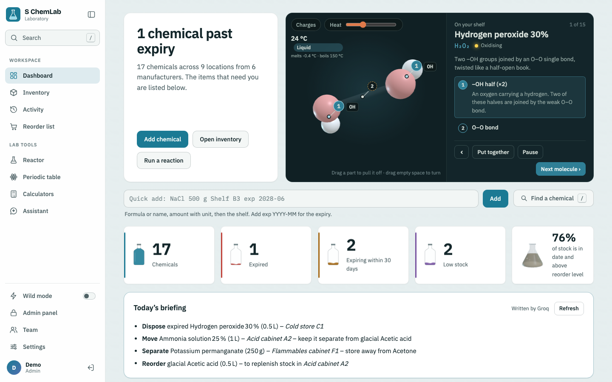
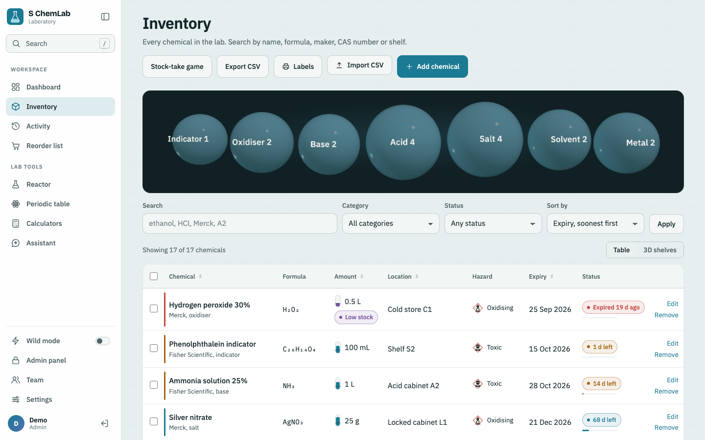
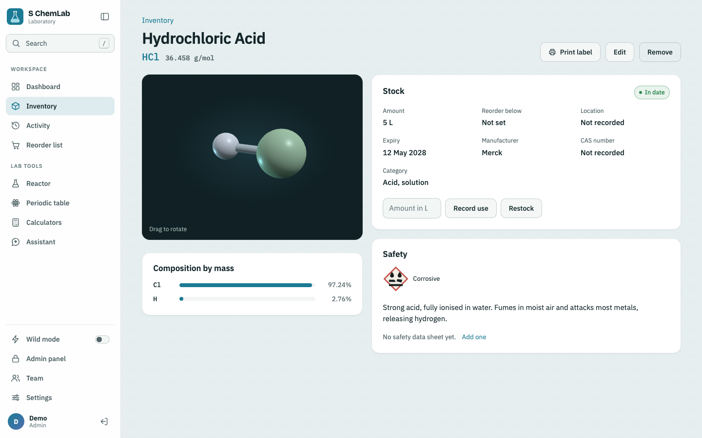
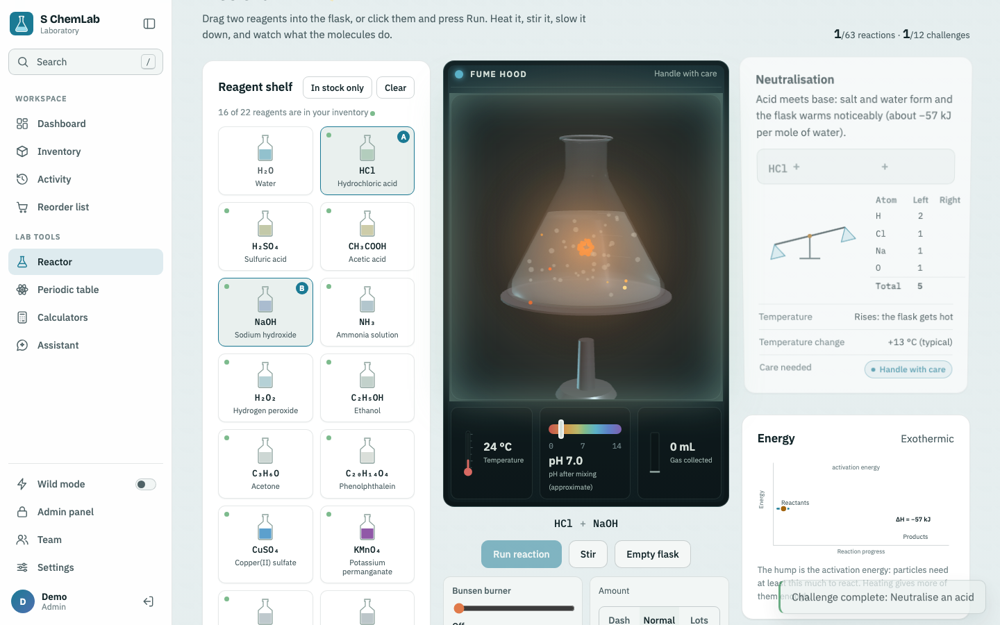
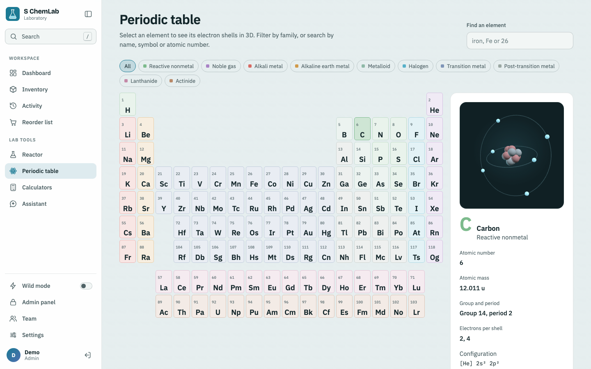
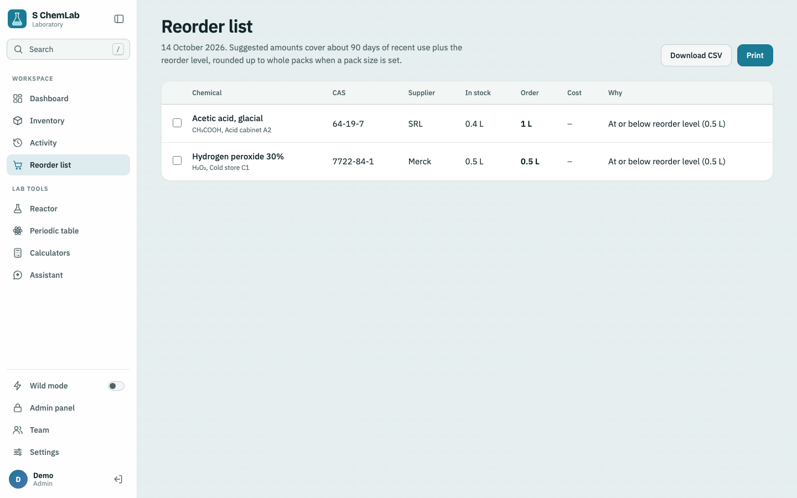
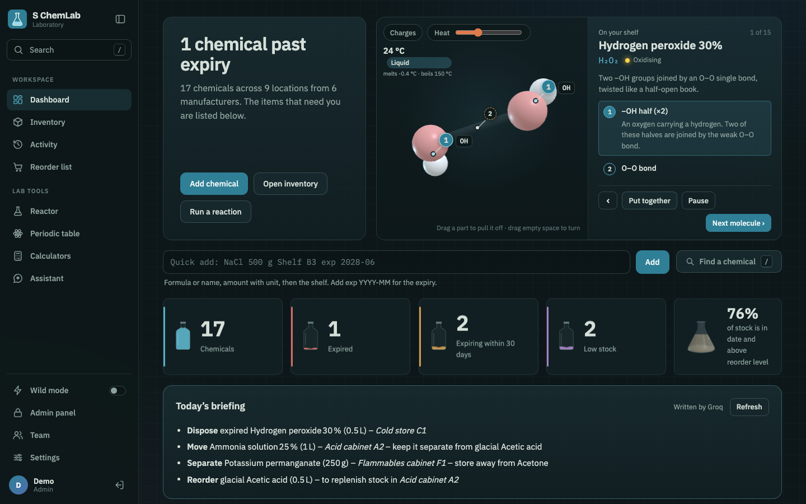
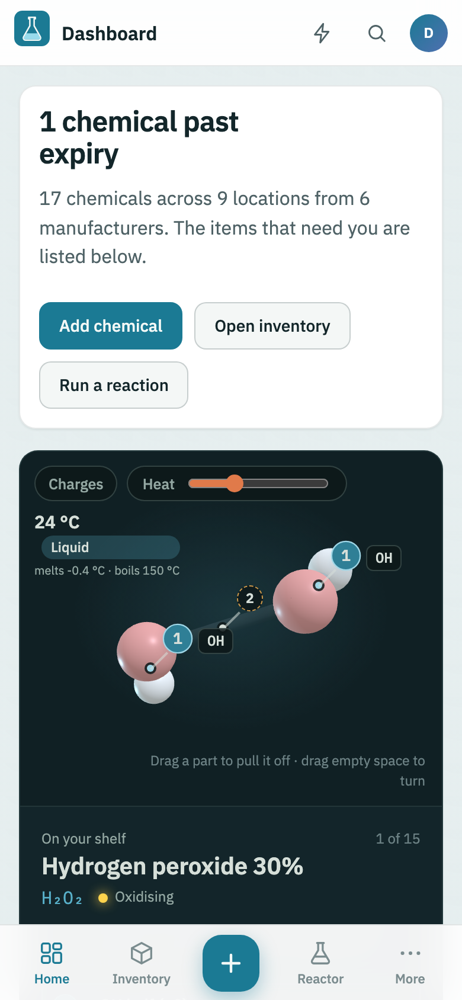
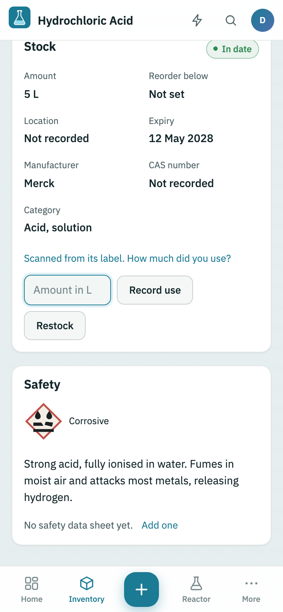

# S ChemLab

**A chemical inventory and lab workspace for a lab team, built with Django.** It tracks every bottle
with expiry, low-stock and storage-conflict alerts. It prints QR labels you scan with a phone to record use,
keeps safety data sheets beside each chemical, and builds a costed reorder list. It also has a 3D reaction
flask, an interactive periodic table, bench calculators and an assistant that knows your live stock.

It runs in any browser on laptops and phones, installs as an app, and deploys to Render's free plan in a few clicks.



## Features

**Inventory**
- Search, filter and sort chemicals; CSV import and export; bulk move and dispose
- Alerts for expired and expiring chemicals, low stock, and incompatible chemicals sharing a shelf
- Several GHS hazard classes per chemical, each with its pictogram
- Every change logged with who made it; the latest change can be undone
- Quick add from one line of text: `NaCl 500 g Shelf B3 exp 2028-06`

**Safety and purchasing**
- **QR bottle labels**: print a sheet, stick them on, scan with any phone camera to open the chemical ready to record use
- **Safety data sheets**: upload the PDF or link the supplier's copy; PDFs are stored in the database, so they survive redeploys
- **Reorder list**: suggested amounts from recent usage, rounded up to whole packs, with supplier, catalogue number and estimated cost
- Disposal advice for expired chemicals, based on their most serious hazard

**Team**
- Admin, member and read-only viewer roles
- Sign in with a username, or with Google
- Password reset by email
- An optional alert email listing what needs attention, sent on a schedule

**Lab tools**
- **Reactor**: 22 reagents and 63 reactions in a 3D flask, with heat, stirring, an energy diagram and 12 challenges
- **Periodic table**: all 118 elements with a 3D Bohr model and electron configuration
- **Calculators**: molar mass, equation balancer, mass and moles, dilution, pH
- **Assistant**: answers questions about your stock offline, or connects to Claude or any OpenAI-compatible model

**Everywhere**
- Light, dark and system themes; phone layout with a bottom tab bar
- Installable app with offline access to pages you've opened
- Keyboard: `/` or `Ctrl K` to search, `Alt` + `1`–`8` to jump between pages

## Screenshots

| | |
| --- | --- |
|  |  |
| Inventory with hazards, stock gauges and expiry | A chemical: 3D model, stock, safety and history |
|  |  |
| Reactor | Periodic table |
|  |  |
| Reorder list with pack sizes and cost | Dark theme |

<p>
  
  
</p>

## Run it on your computer

You need Python 3.12 or newer.

```bash
git clone https://github.com/nikhilsoni6952-tech/Schem-lab.git
cd Schem-lab
python -m venv .venv
source .venv/bin/activate          # Windows: .venv\Scripts\activate
pip install -r requirements.txt
python manage.py migrate
python manage.py runserver
```

Open http://127.0.0.1:8000. The first time, it asks you to create the admin account.

| Command | What it does |
| --- | --- |
| `python manage.py seed_lab` | Loads 16 sample chemicals (safe to run twice) |
| `python manage.py test` | Runs the test suite |
| `python manage.py send_alerts --dry-run` | Shows the alert email and who would get it, without sending |
| `python manage.py changepassword <username>` | Sets a new password from the command line |

The Django admin is at `/admin/`, for admins.

## Put it online

The repository is ready for [Render](https://render.com), and the free plan works:

1. On Render, choose **New → Blueprint** and pick this repository. `render.yaml` creates a PostgreSQL
   database and the web app, generates the secret keys and serves it over HTTPS.
2. Open the `.onrender.com` address and create the admin account.
3. Optional: fill in the email, Google and AI settings below in the service's **Environment** tab.

To bring a local inventory along, use **Inventory → Export CSV** on your computer and **Import CSV** online.
Rows that match on name, formula and location are updated; the rest are added.

Other hosts (Railway, Heroku, a VPS) work too, with the included `Procfile` and `build.sh`.
Production mode forces HTTPS, secure cookies and HSTS. It serves compressed, long-cached static
files with WhiteNoise and answers health checks at `/healthz/`.

## Configuration

Settings come from environment variables, or from a `.env` file in development; copy `.env.example`
to start one. `.env` is never committed.

| Variable | Needed for | Value |
| --- | --- | --- |
| `DJANGO_DEBUG` | Production | `0` |
| `DJANGO_SECRET_KEY` | Production | A long random string. The app refuses to start without one. |
| `DATABASE_URL` | Production | A PostgreSQL URL. Without it, SQLite is used, which a host's disk may wipe. |
| `DJANGO_ALLOWED_HOSTS` | Production | Your domain, e.g. `lab.example.org`. Render and Railway add theirs automatically. |
| `DJANGO_CSRF_TRUSTED_ORIGINS` | Custom domain | `https://lab.example.org` |
| `DJANGO_TIME_ZONE` | Optional | Default `Asia/Kolkata` |
| `EMAIL_HOST`, `EMAIL_PORT`, `EMAIL_HOST_USER`, `EMAIL_HOST_PASSWORD`, `DEFAULT_FROM_EMAIL` | Password reset, alert emails | An SMTP account. For Gmail, use an [App Password](https://myaccount.google.com/apppasswords). |
| `ALERTS_CRON_KEY` | Scheduled alert emails | A secret for `/alerts/send/` (Render generates one) |
| `SITE_URL` | Alert emails | The public address for links in emails (Render sets its own) |
| `GOOGLE_CLIENT_ID`, `GOOGLE_CLIENT_SECRET` | Sign in with Google | From Google Cloud Console |
| `GOOGLE_ALLOWED_DOMAINS` | Optional | Let people sign in without being added first, e.g. `myuniversity.edu`, or `*` |
| `ANTHROPIC_API_KEY`, or `AI_API_KEY` + `AI_BASE_URL` + `AI_MODEL` | Optional | Connects the assistant to a model |
| `LAB_CURRENCY` | Optional | Currency symbol on the reorder list. Default `₹`. |

## Accounts and roles

Every page needs a sign-in. Admins add people under **Team** and choose a role:

| Role | Can |
| --- | --- |
| Admin | Everything, plus adding people, changing roles, resetting passwords and switching accounts off |
| Member | Add, edit, use, restock and dispose of chemicals; import CSV; upload safety data sheets |
| Viewer | Read only: browse, search, print labels, open safety data sheets, and use the lab tools |

Switched-off accounts keep their history in the activity log.

### Sign in with Google

1. In [Google Cloud Console → Credentials](https://console.cloud.google.com/apis/credentials), create an
   **OAuth client ID** of type **Web application**.
2. Under **Authorized redirect URIs**, add `http://127.0.0.1:8000/auth/google/callback/`, and
   `https://<your-site>/auth/google/callback/` once the app is online.
3. Set `GOOGLE_CLIENT_ID` and `GOOGLE_CLIENT_SECRET`, then restart.

A Google account gets in when its email matches an active account here. With `GOOGLE_ALLOWED_DOMAINS` set,
new people from those domains get a viewer account on first sign-in, and an admin can raise the role.

## Email: password reset and alerts

Once `EMAIL_HOST` is set, the sign-in page shows **Forgot your password?** The emailed link works once,
for 24 hours. Anyone can also turn on **Alert emails** under Settings. The email lists expired and expiring
chemicals with disposal advice, low stock and storage conflicts, and nothing is sent when all is well.

Send alerts on a schedule (weekly works well) in either of these ways:
- Run `python manage.py send_alerts` from cron (`0 8 * * 1` is Mondays at 8:00), Render cron jobs or Heroku Scheduler.
- On a free host, have a free scheduler such as [cron-job.org](https://cron-job.org) open
  `https://<your-site>/alerts/send/?key=<ALERTS_CRON_KEY>`.

During development, without `EMAIL_HOST`, emails are printed in the `runserver` console.

## Labels, safety data sheets and purchasing

- **Labels**: use **Inventory → Labels**, select chemicals and choose **Labels**, or press **Print label** on a chemical.
  Labels come in small (3 across) and large (2 across). Each QR code points at `/c/<id>/` on the address
  you printed from, so print from the online app: a code made on `127.0.0.1` won't open on a phone.
- **Safety data sheets**: on a chemical's **Edit** page, upload the PDF (up to 5 MB) or paste a link.
- **Purchasing**: also on the **Edit** page: supplier, catalogue number, pack size, price per pack and order page.
  The reorder list rounds up to whole packs and estimates the total. All of these are columns in the CSV.

## The assistant

Without a key, the assistant uses a built-in offline engine. It covers inventory questions, molar mass,
equation balancing, pH, mole conversions, reactions, element data and safety procedures. To connect a model,
set `ANTHROPIC_API_KEY`, or `AI_API_KEY`, `AI_BASE_URL` and `AI_MODEL` for any OpenAI-compatible provider
(Groq, Gemini, OpenAI, OpenRouter, Ollama). The model receives your inventory and alerts with each question.
If the provider fails, the assistant says so and answers offline. Each person can ask 30 questions per 10 minutes.

## Appearance

**Settings** controls these for each device:
- Theme: light, dark or system
- Effects: Minimal, Standard or Full
- Sound on or off

The ⚡ switch turns on **Wild mode**: an aurora background, neon borders, a particle cursor and a few secrets.
Effects switch off for anyone whose device asks for reduced motion.

## Development

```bash
python manage.py test        # 67 tests: chemistry engine, inventory, roles, CSV, email, labels, error pages
```

```
laboratory/
  models.py            Chemical, SafetySheet, Activity (with undo)
  views.py             pages and JSON endpoints
  views_accounts.py    sign-in, password reset, settings, team, alert hook, health check
  forms.py             the chemical form, safety data sheet upload
  inventory.py         alerts, storage-conflict rules, usage forecast, reorder list
  alerts.py            the alert email
  importer.py          CSV import
  chem.py              elements, formula parser, molar mass, equation balancer, pH
  reactions.py         reactor reagents and reactions
  brain.py, ai.py      offline assistant and AI provider connection
  google_auth.py       Sign in with Google
  middleware.py        keeps viewer accounts read-only
templates/             pages; base.html is the app shell, sw.js the offline service worker
static/js/lab3d.js     three.js engine for molecules, atoms and the flask
static/css/lab.css     the whole theme, with light and dark tokens
render.yaml, build.sh, Procfile    hosting
```

Built with Django 5.2, PostgreSQL or SQLite, WhiteNoise, three.js and segno (QR codes).
